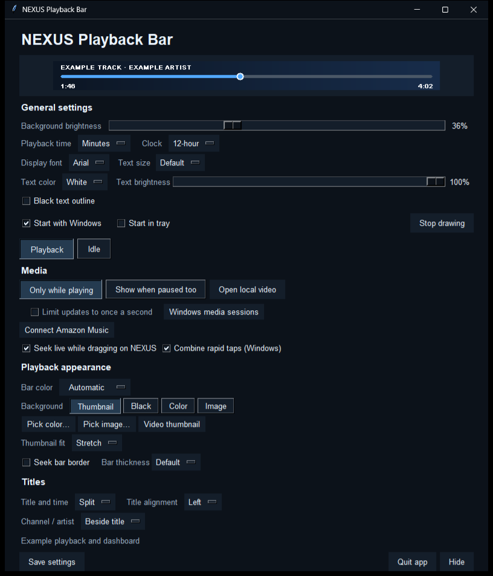
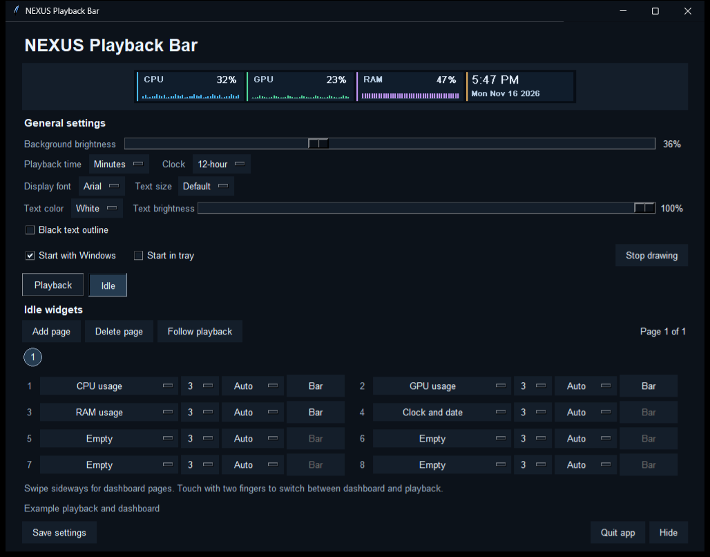

# NEXUS Playback Bar

Turn your Corsair iCUE NEXUS into a touchscreen playback bar and an idle dashboard on Windows. Tap to jump, drag to scrub, or switch to a page of system stats, app shortcuts, pictures, or animated GIFs.

## Download and install

Download the latest public package from [Releases](../../releases). The screenshots and feature guide below show **Windows Preview 29**. Its desktop playback and idle dashboard features are still in preview.

1. Install Python 3 for Windows with Tkinter and the Python launcher (`py.exe`), and connect the NEXUS by USB.
2. Extract the entire ZIP and run `Install-NEXUS.cmd`. Open **NEXUS Playback Bar** from Start.
3. For Chrome playback, open `chrome://extensions`, enable **Developer mode**, select **Load unpacked**, and choose the extracted `chrome` folder. Keep that folder in place and refresh your media tabs.
4. If you run iCUE alongside NEXUS Playback Bar, use the [module workaround](#use-nexus-playback-bar-while-icue-is-running) below. You can also fully quit iCUE from its tray menu.

To update, **Quit** the running app from its tray menu, run the new installer, and relaunch from Start. For Chrome, replace the contents of your existing unpacked extension folder and click **Reload** in `chrome://extensions`, or load the new folder and disable the old copy. Refresh your media tabs afterward. Windows settings carry over.

## Playback

- Tap the timeline on the NEXUS to jump, or drag along it to scrub. Enable **Seek live while dragging on NEXUS** to send seek requests during the drag. With it off, the app previews your position and seeks when you lift your finger. **Combine rapid taps (Windows)** groups quick taps for Windows media sessions.
- Choose **Only while playing** or **Show when paused too**. The app can show elapsed time, duration, title, and artist or channel. Playback time can show total minutes or hours, and the title and credits can use separate positions. Long titles scroll.
- Use **General settings** to pick the display font, size, text brightness, and outline. The **Playback** tab has seek bar color, border and thickness, plus thumbnail, solid color, or custom image backgrounds. Artwork availability depends on the source.
- Windows desktop playback works through Windows media sessions. **Windows media sessions** shows what the app detects. Titles and artwork depend on what the player exposes, and seeking requires a usable timeline and seek controls. **Connect Amazon Music** provides an additional integration for the Windows Amazon Music app. The Chrome extension is needed for Chrome playback.

### Confirmed web compatibility

| Web player | Status |
| --- | --- |
| YouTube | Confirmed working |
| Apple Music | Confirmed working |
| Spotify Web Player | Confirmed working |
| Amazon Music | Confirmed working |
| SoundCloud | Confirmed working |
| Select other streaming sites | Confirmed on tested sites only |

These results are for tested web players. Prime Video and additional web and desktop players are still being evaluated. Embedded players, ads, and live streams can expose different controls.

## Idle dashboard

1. Open the **Idle** tab. Add a page, choose widgets in up to eight slots, and use sizes **1–5** to adjust their relative widths.
2. Pick from system widgets covering CPU, GPU, RAM, VRAM, storage, network, battery, uptime, date, and time. Usage graphs offer **Bar** or **Line** and preset accent colors. Combined readings can show CPU/GPU frequencies or RAM capacity.
3. Under **App shortcuts**, select **Custom app** to browse to a Windows executable or shortcut. Use **Name** to set the label or show only the icon. **Fit / Stretch** controls how the icon fills the widget.
4. Under **Images**, choose **Picture / GIF** to import a local image. GIFs loop, and each image has an independent brightness slider and **Fit / Stretch** setting.
5. Swipe left or right on the NEXUS to move between idle pages. Click the numbered circles in the Windows app to select a page directly.

To switch between playback and idle, place two fingers **at least one inch apart** near the top of the NEXUS and swipe **straight down**. Start away from the round playback position marker to reduce accidental seeks. Use **Follow playback** on the Idle tab to return to automatic switching.

## Tray controls

Left-click the tray icon to reopen settings. Right-click it to **Quit**. **Start with Windows** and **Start in tray** are independent settings. **Stop drawing** blanks the NEXUS until you choose **Resume drawing**.

The Chrome extension sends playback state to the Windows app through a local bridge at `127.0.0.1`. The app can request artwork from the website or its image host.

## Use NEXUS Playback Bar while iCUE is running

Tested on **iCUE 5.52.93**. This lets iCUE manage your other Corsair devices while NEXUS Playback Bar controls the NEXUS screen.

1. In **iCUE → Settings → Software Updates**, turn off **Automatic Download**.
2. Unplug the NEXUS. A **trash icon** will appear to the right of **iCUE NEXUS** in the Software Updates list. Click it to remove the NEXUS software module.
3. Plug the NEXUS back in. Click the **×** on the **New Device Detected** popup to close it. Leave **Download and Install** untouched so iCUE keeps the module uninstalled.
4. You can ignore the **New Device Detected** tile on the iCUE Home screen and use NEXUS Playback Bar with iCUE still running.

With **Automatic Download** off, check for iCUE updates manually. If the trash icon is missing or the screen still flickers, fully quit iCUE from the system tray before using NEXUS Playback Bar.

## Feedback and bug reports

NEXUS Playback Bar is still in development. If you find a bug or a website that doesn’t work as expected, please [open a GitHub issue](../../issues/new) so I can look into it and fix it. Include the website or page URL, what you expected, what happened, and your app and extension versions.

## Support this project

If you’d like to leave a tip, you can [support me on Ko-fi](https://ko-fi.com/andypa4).

If NEXUS Playback Bar makes your NEXUS more useful, you can support the project by starring this repository or sharing it with someone who owns a NEXUS. Bug reports and feedback are welcome, too.

NEXUS USB support uses [NexusTool by willneedit](https://github.com/willneedit/NexusTool). Its MIT license is included in [NexusTool-LICENSE.txt](NexusTool-LICENSE.txt).
